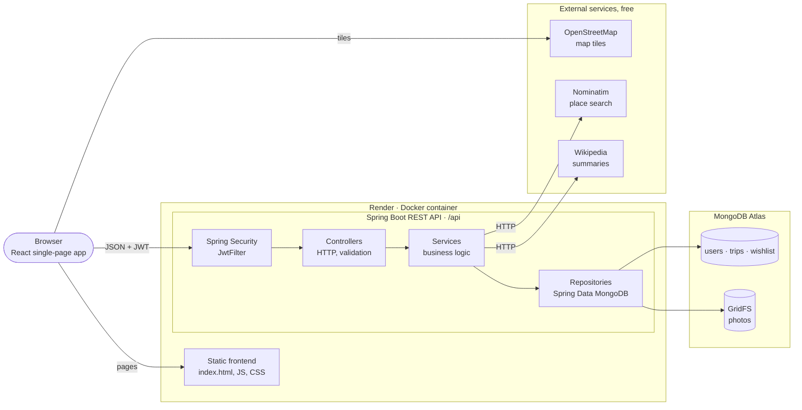
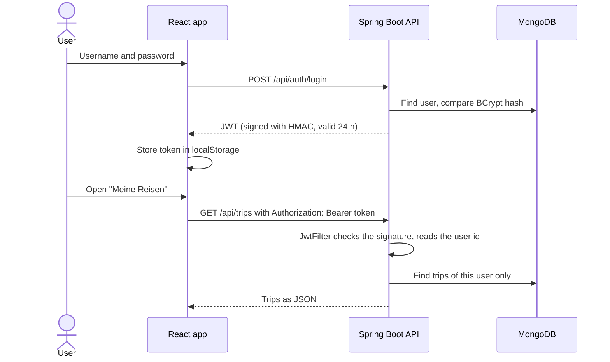
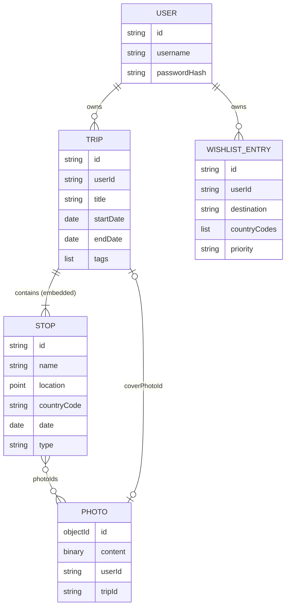
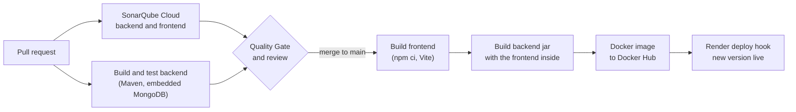

# TravelBlog

**A personal travel diary on a map.** Record your trips stop by stop, add photos and notes, see your routes and every
country you have visited, and keep a wishlist of places you still want to see.

[](https://github.com/dinara-mfl/TravelBlog/actions/workflows/deploy.yml)
[](https://sonarcloud.io/summary/new_code?id=dinara-mfl_TravelBlog_backend)
[](https://sonarcloud.io/summary/new_code?id=dinara-mfl_TravelBlog_frontend)


TravelBlog is a full-stack group project of three developers, **built in 10 working days** in a Java + React
bootcamp: a Spring Boot REST API with MongoDB, a React single-page app with interactive maps, and a CI/CD pipeline that
tests, analyzes, and deploys every change.


## Try it live

**[travelblog-latest.onrender.com](https://travelblog-latest.onrender.com/)**. Log in with the demo account, no
registration needed:

| Username | Password   |
|----------|------------|
| `demo`   | `12345678` |

The demo account has four sample trips (Italy, Portugal, Iceland, Japan) with photos, and a wishlist. Feel free to
change or delete anything: the demo data is reset whenever the service restarts.

> The app runs on Render's free plan, which sleeps after a while without visitors. The first page load can take about a
> minute; after that it is fast. If the server falls asleep while the app is open, the app shows a note while it wakes
> up.

The user interface is in German and English: switch with **DE | EN** in the top right corner.

## Highlights

- **10 working days, 3 developers, 40+ reviewed pull requests:** feature branches, code review by a teammate, and a
  protected `main` branch
- **Continuous deployment:** every merge is tested, packaged as a Docker image, and live on Render within minutes
- **140+ automated backend tests** with MockMvc and an embedded MongoDB; coverage measured with JaCoCo
- **SonarQube Quality Gate on every pull request**, for the backend and the frontend
- **20 REST endpoints**, secured with Spring Security and JWT; every user sees and changes only their own data
- **Interactive maps** with Leaflet: the route of each trip and a world map of all visited and wished-for countries
- **Three external services** integrated without API keys: OpenStreetMap, Nominatim place search, and Wikipedia
- **Polished details:** photo upload with gallery and cover photo, skeleton loading, a demo account with sample data

## Screenshots

| Trip with route map | Stops with photos and Wikipedia |
|---|---|
|  |  |
| **World map: visited countries and wishes** | **Statistics** |
|  |  |
| **Wishlist** | |
|  | |

## Features

**Trips and stops**
- Create trips with dates, description, tags, and a cover color or cover photo
- Add stops by searching for a place (OpenStreetMap / Nominatim); each stop has a date, a note, and a type:
  overnight stay, passing through, or day trip
- The route is drawn on a map in the order of the visit; day trips are shown with their distance from the last
  overnight stop
- Route length and distance between stops, calculated from the coordinates
- Up to five photos per stop, a gallery with a large view, and a cover photo for the trip
- A short Wikipedia summary for every stop, with a link to the full article

**Overview**
- Search trips by place, country, or keyword; filter by year and tags
- **World map:** every visited country is colored, wishlist countries in a second color; clicking a country lists its
  trips and wishes
- **Statistics:** totals, records (longest trip, longest route, most stops), and breakdowns by year, country, and month

**Wishlist**
- Destinations with one or more countries, an optional place or region, a reason, a priority, and the best time to
  travel
- **Plan a trip:** turns a wish into a new trip with the destination already filled in

**Accounts and languages**
- Registration and login; every user sees and changes only their own data
- German and English user interface, including dates, numbers, country names, error messages, place search, and
  Wikipedia

## Tech stack

| Area | Technologies |
|---|---|
| Frontend | React 19, TypeScript, Vite, React Router, Tailwind CSS v4, Leaflet with react-leaflet, axios |
| Backend | Java 25, Spring Boot 4.1 (Web MVC, Validation, Security, Data MongoDB), Lombok, jjwt |
| Database | MongoDB Atlas; photos in GridFS |
| External services | OpenStreetMap tiles, Nominatim place search, Wikipedia API (all free, no API key) |
| Quality | JUnit 5 with MockMvc and an embedded MongoDB, JaCoCo, SonarQube Cloud, oxlint |
| CI/CD | GitHub Actions, Docker, Docker Hub, Render |

## Architecture

### System overview

The backend and the built frontend run together in **one Docker container**. The browser loads the React app and
calls the REST API on the same address, so there is no CORS setup. Every endpoint under `/api` requires a JWT, except
registration and login.



The backend calls Nominatim and Wikipedia itself instead of the browser. That keeps the frontend simple, lets the
backend shape the answers, and keeps the external base URLs in configuration (`application.properties`), where the
tests can replace them.

### Backend layers

Each feature follows the same path: **Controller → Service → Repository**.

| Layer | Package | Responsibility |
|---|---|---|
| Controller | `controller` | HTTP mapping, request validation (`@Valid`), reads the logged-in user from the JWT |
| Service | `service` | Business rules: ownership checks, route and distance calculation, titles, photo handling |
| Repository | `repository` | MongoDB access through Spring Data; every query includes the user id |
| Model / DTO | `model`, `dto` | Java records: documents in the database, requests and responses of the API |

Errors are turned into a uniform JSON answer (`ProblemDetail`) in one place, `GlobalExceptionHandler`, so the
frontend can show field errors next to the right input.

### Login with JWT



The backend stays stateless: no sessions, no CSRF tokens. On a `401` answer the frontend removes the token and opens
the login page.

### Data model



Stops are embedded in their trip, because they are always read and changed together with it. Photos are stored in
GridFS, the MongoDB storage for files, with the owner in their metadata.

### Frontend

| Folder | Content |
|---|---|
| `pages/` | One component per route: trips, trip detail, world map, statistics, wishlist, login, registration |
| `components/` | Reusable parts such as `TripMap`, `WorldMap`, `TripDialog`, `PhotoLightbox`, `WikipediaInfo` |
| `api/` | axios calls per resource; `client.ts` adds the token and handles `401` |
| `utils/`, `types/` | Pure helper functions (filters, dates, countries) and TypeScript types of the API |

The Vite dev server forwards `/api` to the backend, so the frontend uses the same relative URLs locally and in
production.

### CI/CD pipeline



`main` is protected: every change goes through a pull request with a passing build, a passing SonarQube Quality Gate,
and a review by a teammate. Merging deploys automatically.

More details are in the [documentation](#documentation).

## Documentation

The project was planned before it was built: requirements first, then page mockups, then the architecture. The
documents were kept up to date with every pull request.

| Document | Content |
|---|---|
| [`docs/requirements.md`](docs/requirements.md) | What the application should do: features, rules, non-functional requirements, non-goals |
| [`TravelBlog – Seitenentwürfe.html`](TravelBlog%20–%20Seitenentwürfe.html) | Page mockups of the trip overview, trip detail, world map, and wishlist (open the file in a browser) |
| [`docs/architecture.md`](docs/architecture.md) | Architecture decisions and their reasons, e.g. data model, maps, photos, security |
| [`docs/deployment.md`](docs/deployment.md) | How a deployment runs, required secrets and environment variables |
| [`CLAUDE.md`](CLAUDE.md) | Working rules for the AI coding assistant (Claude Code): tech stack, commands, architecture and code quality rules, Git workflow |

## Project structure

```
TravelBlog/
├── backend/                 Spring Boot application
│   └── src/main/java/org/example/backend/
│       ├── config/          clients for Nominatim and Wikipedia
│       ├── controller/      REST endpoints under /api
│       ├── dto/             request and response records
│       ├── exception/       uniform error answers
│       ├── model/           MongoDB documents
│       ├── repository/      Spring Data repositories
│       ├── security/        Spring Security and the JWT filter
│       └── service/         business logic
├── frontend/                React application (Vite)
│   └── src/                 pages, components, api, utils, types
├── docs/                    requirements, architecture, deployment, screenshots
├── .github/workflows/       CI, SonarQube analysis, deployment
└── Dockerfile               one image with backend and frontend
```

## Team

| | Main contributions |
|---|---|
| **Natalia Dybina** ([@NataliaDybina](https://github.com/NataliaDybina)) | Trip list with filters and tags, stops and stop types, trip route map, statistics page, Wikipedia integration, deployment pipeline |
| **Dinara Mufaizalova** ([@dinara-mfl](https://github.com/dinara-mfl)) | Registration and login with JWT, creating trips, trip detail page, photo upload with gallery and cover photo, CI and test coverage |
| **Frank David Lee** ([@codeByFrank](https://github.com/codeByFrank)) | Wishlist, world map with visited countries and wishes, "plan a trip" from a wish, demo account, deployment fixes |

## Running locally

### Prerequisites

- JDK 25
- Node.js with npm (a current LTS version)
- A MongoDB database: either installed locally or a free MongoDB Atlas cluster

### 1. Configure the environment variables

The backend needs two environment variables; without them it does not start:

| Variable | Purpose |
|---|---|
| `MONGODB_URI` | Connection string of the MongoDB database |
| `JWT_SECRET` | Key that signs the login tokens (JWT) |
| `DEMO_PASSWORD` | Optional: creates the demo user `demo` with sample data (see `docs/architecture.md` → Demo user) |

#### `MONGODB_URI`

The backend reads the MongoDB connection string from the environment variable `MONGODB_URI`
(`backend/src/main/resources/application.properties`: `spring.mongodb.uri=${MONGODB_URI}`).

The database name is part of the URI (the path after the host). If it is missing, MongoDB uses the database `test`,
so always include `/travelblog`.

Local MongoDB:

```
mongodb://localhost:27017/travelblog
```

MongoDB Atlas:

```
mongodb+srv://<user>:<password>@<cluster-host>/travelblog?retryWrites=true&w=majority
```

The URI may contain a password: never commit it, and do not put it into `application.properties`.

#### `JWT_SECRET`

Any random string of at least 32 characters (`app.jwt.secret=${JWT_SECRET}` in `application.properties`). Each
developer can use their own value locally. Generate one with:

```
openssl rand -base64 48
```

Treat it like a password: never commit it. If it changes, existing tokens become invalid and users have to log in
again. The tests use their own value from `backend/src/test/resources/application.properties`.

#### Setting the variables

Set the variables in one of these ways:

- **Terminal (macOS / Linux):** `export MONGODB_URI="mongodb://localhost:27017/travelblog"` and
  `export JWT_SECRET="<your secret>"`, then start the backend from the same terminal.
- **Terminal (Windows PowerShell):** `$env:MONGODB_URI="mongodb://localhost:27017/travelblog"` and
  `$env:JWT_SECRET="<your secret>"`
- **IntelliJ IDEA:** Run → Edit Configurations → `BackendApplication` → Environment variables →
  `MONGODB_URI=mongodb://localhost:27017/travelblog;JWT_SECRET=<your secret>`

Spring Boot does not read `.env` files; the variable has to be set in the environment of the process.

### 2. Start the backend

```
cd backend
./mvnw spring-boot:run
```

The backend runs on `http://localhost:8080`; all endpoints start with `/api` (e.g. `http://localhost:8080/api/trips`).

### 3. Start the frontend

```
cd frontend
npm install
npm run dev
```

Open the URL Vite prints (usually `http://localhost:5173`). The Vite dev server forwards every request to `/api` to
the backend on `http://localhost:8080`, so the backend has to be running.

All pages except login and registration need a logged-in user: register an account on `/register` first, then log
in. With `DEMO_PASSWORD` set, you can also log in as `demo`.

## Tests and checks

Backend (in `backend/`):

```
./mvnw test
```

The tests do not need `MONGODB_URI`, `JWT_SECRET`, or an installed MongoDB: they start an embedded MongoDB
(Flapdoodle) and use a test-only secret from `src/test/resources/application.properties`. The first run downloads the
MongoDB binary, so it needs internet access and takes a bit longer.

Frontend (in `frontend/`):

```
npm run lint
npm run build
```

The frontend has no automated tests (not part of the course); lint, type check, and build are its checks.

## Working together

- Work on a feature branch, never directly on `main`; changes go in via pull requests.
- Never commit secrets (`MONGODB_URI` with a password, `JWT_SECRET`, `.env` files, tokens).
- Read `docs/requirements.md` and `docs/architecture.md` before implementing a feature; update `architecture.md` when a
  decision changes.

## Credits

- Map data © [OpenStreetMap](https://www.openstreetmap.org/copyright) contributors; place search by
  [Nominatim](https://nominatim.org/)
- Country borders from [Natural Earth](https://www.naturalearthdata.com/) (public domain)
- Place summaries from [Wikipedia](https://de.wikipedia.org/) (CC BY-SA 4.0)
- Photos of the demo trips from [Unsplash](https://unsplash.com/) (Unsplash License)
